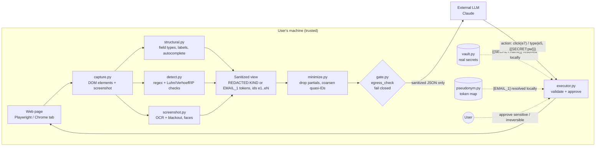

# Zen: privacy-preserving AI browser agent (PS-004)

An AI agent that works on web pages for you, while sensitive data (cards, Aadhaar, PAN, passwords, OTPs,
API keys, phones, emails, IPs, faces, and India-specific IDs: UPI, IFSC, bank accounts, GSTIN, vehicle plates,
voter ID, passport) never reaches the external model.

What makes it different:
- **Consistent pseudonyms**: the model sees `[EMAIL_1]`, `[CARD_1]` rather than blanks, so it can still tell
  that two mentions are the same value, and can type a token to use the real value (after your approval).
- **Measured against inference**: a red-team benchmark checks whether the model could *guess* a redacted
  value from context ("card ending 4242", DOB + PIN code); a minimisation pass removes those hints.
- **Redact before you share**: on Android, share a screenshot from the gallery to Zen and share back a
  redacted copy.

**Core rule:** compute what is sensitive locally; reason globally only on sanitized data.

**Submission:** [demo video (captioned)](submission/Zen_demo.mp4), [8-slide deck](submission/Zen_PECathon.pptx) ([PDF](submission/Zen_PECathon.pdf)), [narration script](submission/narration.md).

Three ways to use it:

| Surface | What it does | Where |
|---|---|---|
| **Agent + demo** (Python) | Drives a real headless browser; the model only ever sees a redacted view and placeholders | `zenlens/`, `demo/` |
| **Web app** (PC + phone, installable PWA) | Before/after privacy preview for text, screenshots and web pages; runs agent tasks; local-only mode | `app/` |
| **Chrome extension** (MV3) | Highlights and masks PII on any page; guards pastes into ChatGPT/Claude/Gemini; works offline | `extension/` |

---

## Architecture and data flow



Step by step (`zenlens/agent.py` loop, wired to a real browser by `zenlens/browser.py`):

1. **Capture** (`capture.py`): headless Chromium snapshots the page. Every visible element gets a stable id
   (`e1`, `e2`, …). Raw DOM and screenshot stay in memory locally.
2. **Detect** (all local, no network):
   - `detect.py` text rules with checksums (Luhn for cards, Verhoeff for Aadhaar, octet/IPv6 validation),
     Devanagari digit normalisation.
   - `structural.py` flags fields by structure even when the text looks harmless: `type=password`,
     `autocomplete=cc-number/one-time-code`, labels like OTP/CVV/PIN/token.
   - `screenshot.py` OCRs the screenshot (Apple Vision or Tesseract), blacks out PII boxes and DOM-flagged
     element boxes, optional face blackout (OpenCV). Fails closed: never returns an unredacted image.
3. **Sanitize**: values become `[REDACTED:KIND]`, or in pseudonym mode stable tokens (`[EMAIL_1]`, `[CARD_1]`;
   same value ⇒ same token across the page, the goal and every step). URL query/fragment dropped.
4. **Minimise** (`minimize.py`, on by default for agent runs and previews): removes what would let a model
   infer a redacted value: partial values ("ending 4242", `98XXXXX210`, `a***@`), values echoed in URLs,
   titles, alt/aria text, and exact quasi-identifiers (DOB → year, exact age → band, PIN code → district).
5. **Gate** (`gate.py`): every outbound payload is re-scanned; any PII, vault value or canary ⇒ `Blocked`.
   A scanner error also blocks.
6. **Reason**: the model receives only the sanitized view and returns an action. Page text is marked
   UNTRUSTED in the system prompt.
7. **Validate** (`executor.py`): allowed action types, target id must exist, navigation only to allowed
   origins, typed text must be non-sensitive or exactly one `{{SECRET:name}}` placeholder whose kind matches
   the field (a password can't go into a comment box). Pseudonym tokens follow the same rule.
8. **Approve**: vault and token substitutions and irreversible clicks (submit/pay/delete/send…) need the user's OK;
   default deny.
9. **Execute**: the executor resolves the placeholder (vault) or token (pseudonym map) and fills the real field. The
   real value never appears in model payloads, history, logs or reports.

## Setup

```bash
python3 -m venv .venv
.venv/bin/pip install -r requirements.txt
.venv/bin/python -m playwright install chromium
```

Optional: `brew install tesseract` (OCR on non-macOS; macOS uses Apple Vision by default),
`export ANTHROPIC_API_KEY=...` for real Claude runs.

## Run

```bash
.venv/bin/python -m pytest -q                       # tests
.venv/bin/python -m eval.run_eval                   # detector benchmark (exit 1 on any counted leak)
.venv/bin/python -m eval.inference.run             # inference red-team: plain vs minimised (exit 1 on a leak)
.venv/bin/python demo/run_demo.py --yes             # narrated end-to-end demo, scripted model
.venv/bin/python demo/run_demo.py --pace 1.5 --headed --yes   # slower, visible browser, for recording
.venv/bin/python demo/run_demo.py --claude --yes    # real Claude (needs ANTHROPIC_API_KEY)
```

**Specimen documents for live demos** (`demo/docs/`, regenerate with `.venv/bin/python demo/make_docs.py`):
a bank statement, GST tax invoice and KYC form as PNG (Screenshot screen or phone share), plus a Hinglish
support chat (`.txt`) and a server incident log (`.log`) for the Text screen's *Attach file*. All
organisations and people are fictional; IDs are checksum-valid so every detector fires.

Demo scenes: (1) checkout page detection + redacted screenshot, (2) sign-in with vault secrets and
approvals, (3) card payment from the vault, raw card typed by the model rejected, (4) prompt-injection page:
all 5 hijack attempts blocked, (5) gate blocks PII payloads, (6) leak audit: 0 vault values in any payload
or report.

### Web app (PC and phone)

```bash
.venv/bin/python -m app.server            # PC: open http://127.0.0.1:8765/ (localhost only, no token)
.venv/bin/python -m app.server --lan      # phone: scan the printed QR / open http://<LAN-IP>:8765/#token=…
```

The server runs on your own machine; the phone reaches it over Wi-Fi. The token sits in the URL fragment
(never sent to the server or its logs), is stored by the page, and every POST needs `X-Zen-Token`
in LAN mode. Flags: `--local-only` (disables Claude mode; the on-device model still works), `--port`, `--token` / `ZENLENS_TOKEN`,
`--cert`/`--key` for your own HTTPS certificate, `--https` to have one made with mkcert.

**Install on a phone (needed for share-to-redact):**

```bash
brew install mkcert && mkcert -install           # once, on the Mac
.venv/bin/python -m app.server --lan --https     # makes a cert for localhost + LAN IP in app/certs/ (gitignored)
```

It prints the phone link, a QR code and the Android steps: copy `$(mkcert -CAROOT)/rootCA.pem` (never
`rootCA-key.pem`) to the phone, install it under Settings → Encryption & credentials → Install a
certificate → CA certificate, then open the link in Chrome → Install app.

Screens (mobile bottom bar / desktop tabs, light/dark, no CDNs, strict CSP):
- **Text**: before/after with spans coloured by kind and a "why redacted" explanation per span; Redact /
  Pseudonym toggle with a token legend.
- **Screenshot**: phone camera or file upload → redacted image with a before/after slider, optional face blur.
- **Share to redact** (`/share.html`): on Android, Gallery → Share → Zen → redacted copy → Share again. The
  original is deleted from the phone's cache immediately and only ever sent to your own server. iOS has no
  Web Share Target, so on iPhone open `/share.html` and pick the photo; sharing the result works.
- **Web page**: URL or bundled test page → redacted screenshot + sanitized element list.
- **Agent task**: goal + page, scripted demo or Claude; each step's verdict (allowed / rejected / needs
  approval) and a **"Data that left this device"** panel showing the exact sanitized payloads. In pseudonym
  mode the model's answer is shown twice: as sent (tokens) and "on this device only" (real values).
- **On-device planner (Ollama)**: the Agent tab can use a small local model instead of Claude, so even the planning step never leaves your machine. Install [Ollama](https://ollama.com), then `ollama pull qwen2.5:0.5b` (about 400 MB; set `ZENLENS_OLLAMA_MODEL=qwen2.5:1.5b` for a stronger plan) and keep it running; the app detects it. The model gets the same sanitized view and the same egress gate as Claude, and the host must be loopback (`OLLAMA_HOST` pointing elsewhere is refused). Small models plan worse than Claude: the executor still validates every action, so a bad plan is rejected, not run.
- **Settings**: local-only mode, custom regex rules (validated server-side), connection status.

API (port 8765, also used by the extension): `GET /api/health`, `POST /api/sanitize`,
`/api/sanitize_html`, `/api/redact_image`, `/api/preview`, `/api/agent/run`, `/api/gate`. Findings carry
offsets and kinds only, never values. Optional fields: `mode: "pseudonym"` and `minimize: true` on
`/api/sanitize`; `privacy_mode` and `minimize` (default true) on `/api/preview` and `/api/agent/run`.
Errors never echo input; request bodies are never logged; other
web origins are refused (only same-origin and `chrome-extension://`).

### Chrome extension

Load it: `chrome://extensions` → Developer mode → **Load unpacked** → pick `extension/`. Reload tabs that
were already open (or click the Zen icon once). Details and permission justifications:
[extension/README.md](extension/README.md).

- **Works offline.** `lib/detect.js` is an exact port of `detect.py`: identical spans on all 150 eval
  cases (`node --test extension/tests/`; refresh the Python reference with
  `.venv/bin/python extension/tests/dump_py.py`).
- **Highlight and mask**: outlines PII on any page with a per-kind badge; "Mask on screen" blurs it.
  Page text and input values are never modified.
- **AI-chat guard**: on ChatGPT, Claude, Gemini, Copilot and Perplexity (configurable), pasting or sending
  PII opens a dialog that defaults to **Send sanitized** (`[REDACTED:KIND]`).
- **Popup / side panel**: per-kind counts, copy sanitized page text, before/after view, and a redacted
  screenshot (DOM boxes blacked out locally, then OCR via the local server if it's running).
- **Options**: custom rules, AI-site list, allow/deny sites, server URL + token. Detected values are never
  stored. Network access is limited to `localhost:8765`.
- Not verified as a loaded extension in a real Chrome profile yet (popup, side panel, screenshot capture,
  context menu); the detector, content script, guard and options page were exercised in a browser.

## Modules

| File | Role |
|---|---|
| `zenlens/detect.py` | Regex + checksum PII detector (CARD, AADHAAR, PAN, EMAIL, PHONE, IP, API_KEY, TOKEN, PASSWORD, OTP, UPI_ID, IFSC, BANK_ACCOUNT, GSTIN, VEHICLE, VOTER_ID, PASSPORT) |
| `zenlens/sanitize.py` | `[REDACTED:KIND]` replacement |
| `zenlens/pseudonym.py` | `Pseudonymizer`: stable `[EMAIL_1]` tokens, normalisation, local `rehydrate` / `resolve_token` |
| `zenlens/minimize.py` | `minimize(text)`, `minimize_view(view)`: data minimisation against inference |
| `zenlens/gate.py` | Fail-closed `egress_check(payload, canaries)` |
| `zenlens/structural.py` | HTML structural detector: `scan_html`, `sanitize_html`, `element_kind` |
| `zenlens/screenshot.py` | OCR redaction `redact_image(png, extra_boxes, faces)` |
| `zenlens/capture.py` | Playwright `Session`, `PageSnapshot`, `sanitized_view` |
| `zenlens/browser.py` | `PlaywrightPage`: the agent's real-browser `Page` |
| `zenlens/vault.py` | Local secret store, `{{SECRET:name}}` placeholders |
| `zenlens/llm.py` | `Action`, `ScriptedLLM`, `ClaudeLLM` (structured output, egress-checked) |
| `zenlens/executor.py` | Action validation, approval, injection defence |
| `zenlens/agent.py` | Capture → gate → model → validate → execute loop |
| `zenlens/runner.py` | `run_task(...)` and `preview(...)`, used by the web app |
| `app/` | Local FastAPI server + installable PWA (phone and PC); `app/share.py` share target + `--https` |
| `extension/` | Chrome MV3 extension with JS detector port |
| `demo/` | Localhost test-page server and narrated demo |
| `testpages/` | 5 synthetic pages + `.truth.json` ground truth, plus `injection.html` |
| `eval/` | Deterministic case generator + detector benchmark; `eval/inference/` red-team benchmark |

## Evaluation

`eval/make_cases.py` generates 150 synthetic, labelled cases from a fixed seed (valid/invalid Luhn and
Verhoeff numbers computed, not hand-typed) across checkout, auth, support, video and dev-settings
scenarios. Includes hard negatives (order IDs, timestamps, versions, UUIDs, git SHAs, invalid GSTINs, emails
on UPI-like domains, IFSC-shaped SKUs), format variants, Hindi/Hinglish text, canaries and a separately reported adversarial set.

Current results (`python -m eval.run_eval`):

| Metric | Value |
|---|---|
| Recall (non-adversarial) | 0.99 (110/111) |
| Precision | 1.00 |
| Leaks in counted cases | 0 |
| Canaries blocked by gate | 5/5 |
| Context preservation (non-PII tokens unchanged) | 1.00 |
| `detect()` latency | ~0.013 ms mean, ~0.019 ms p95 |
| Adversarial recall (reported, not counted) | 0.20 |

End-to-end tests (`tests/test_e2e.py`, real headless Chromium) prove that vault secrets reach the page
but never appear in model payloads, logs (DEBUG, all loggers) or reports; that every injection hijack is
rejected; and that `preview()` output and OCR of the redacted screenshot contain no ground-truth values.

### Inference red-team (`python -m eval.inference.run`)

48 synthetic scenarios where a value is redacted but the context gives it away. An offline attacker
(exploits partials, checksum completion, cross-field matches, echoes) tries to recover each value with plain
redaction, then with `minimize`. "Leak" = exact recovery, at least 1 bit narrowed, or re-identification
(anonymity set under 20). A `ClaudeAttacker` (`--claude`, needs `ANTHROPIC_API_KEY`) asks the model to guess.

| Category | n | Plain: leak rate | Plain: bits leaked | Minimised: leak rate | Minimised: bits leaked |
|---|---|---|---|---|---|
| Partial values ("ending 4242", masked) | 12 | 1.00 | 14.3 | 0.00 | 0.0 |
| Recomputable (checksum, echoed OTP, hints) | 11 | 1.00 | 36.7 | 0.09 | 1.8 |
| Quasi-identifiers (DOB + PIN + gender) | 9 | 1.00 | 28.3 | 0.00 | 15.2* |
| Cross-field (email from display name) | 8 | 1.00 | 41.7 | 0.12 | 4.8 |
| Context (URL slugs, filenames, aria) | 8 | 1.00 | 34.4 | 0.00 | 0.0 |

\*Coarse attributes only (birth year, PIN district, age band); every anonymity set stays at 20 or more.
The two remaining leaks are tagged known gaps (an OTP repeated in button text; an email rebuilt from an
unlabelled name). Utility cost: 0 of 260 hard-negative tokens changed.

**Zero-leak claims cover only these synthetic cases and tested pathways.** The Claude attacker has not been
run yet, so there is no real-LLM inference measurement.

## Security assumptions and limitations

- **Trusted:** the local machine, the Python process and the browser it drives. The model and its
  provider are untrusted; page content is untrusted (prompt injection).
- **Known gaps:** person names need NER (one known-gap case); obfuscated PII ("anu at example dot com",
  digits with spaces, zero-width characters, lowercase PAN, keys split across strings) is mostly missed.
- **Screenshots:** OCR misses small (< ~12 px), low-contrast or stylised text and text over images; PII
  split across lines isn't joined. DOM-flagged element boxes are blacked out regardless, which covers form
  fields. Haar face detection is weak on profiles and small faces.
- **Inference:** `minimize` handles the patterns in the red-team set; an LLM may still infer from free
  text (spelled-out digits, issuer + network, unlabelled names next to emails). Values glued to `_`/`-` in
  identifiers (`statement_<card>.pdf`, `tel-<phone>`) are missed by `detect.py`.
- **Pseudonyms:** values shorter than 4 characters (e.g. CVVs) are not added as leak canaries (they'd
  collide with ordinary numbers); those fields are still structurally redacted.
- **Share target:** Android Chrome only, installed PWA over trusted HTTPS, phone on the same Wi-Fi.
- **India IDs:** account, voter ID and passport numbers need a nearby keyword; form labels written only in
  Devanagari aren't matched structurally (romanised and free-text Hindi keywords are).
- **Layout leakage:** element positions and field types are visible to the model (needed to act).
- **Retention:** snapshots live in memory for one step; nothing is persisted; logs carry ids, kinds and
  placeholder names only.
- **Local test servers must use `localhost`**, not `127.0.0.1`: IPs are detected, so an IP in the URL is
  blocked by the gate.
- Synthetic data only throughout; never test with real PII.

Reference only: `~/Desktop/Github-C` (third-party project, not copied).
